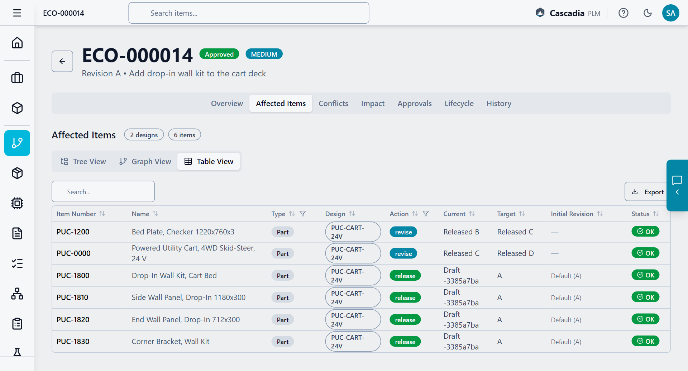
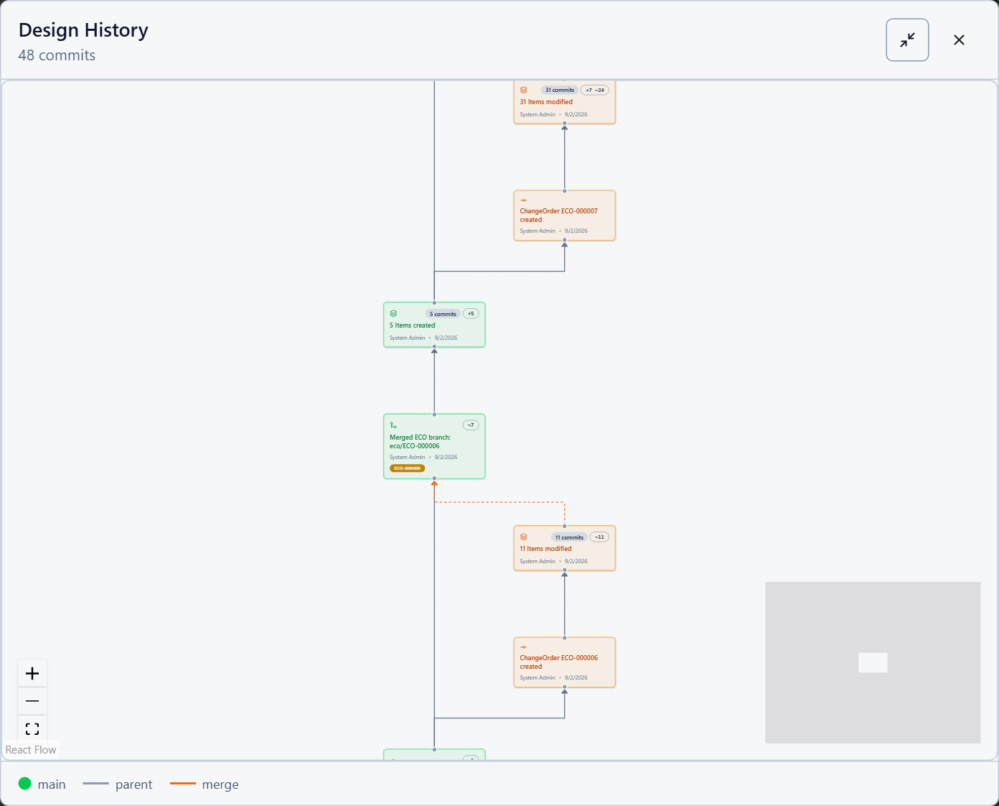
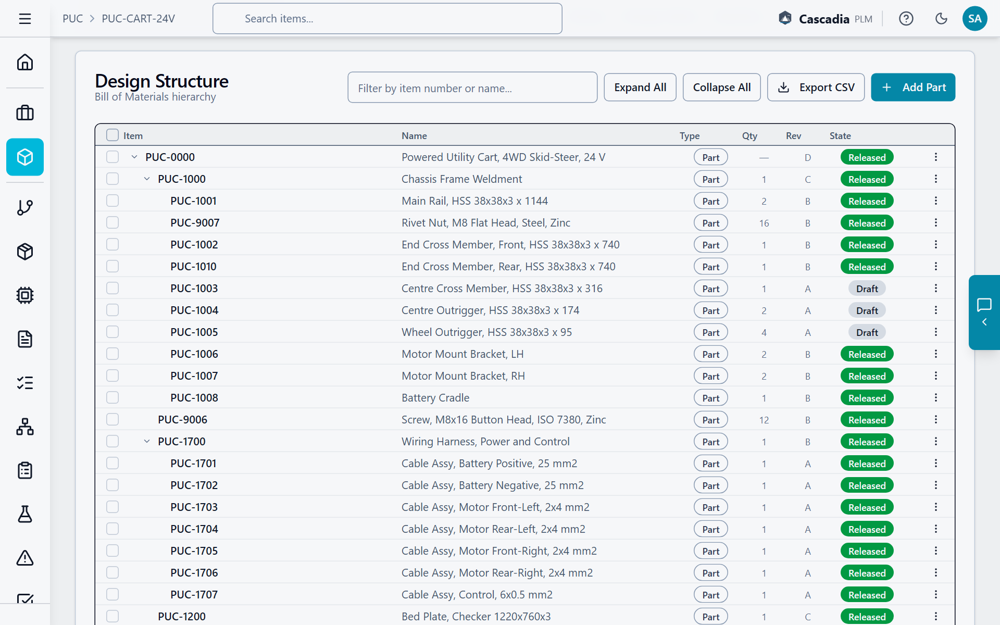
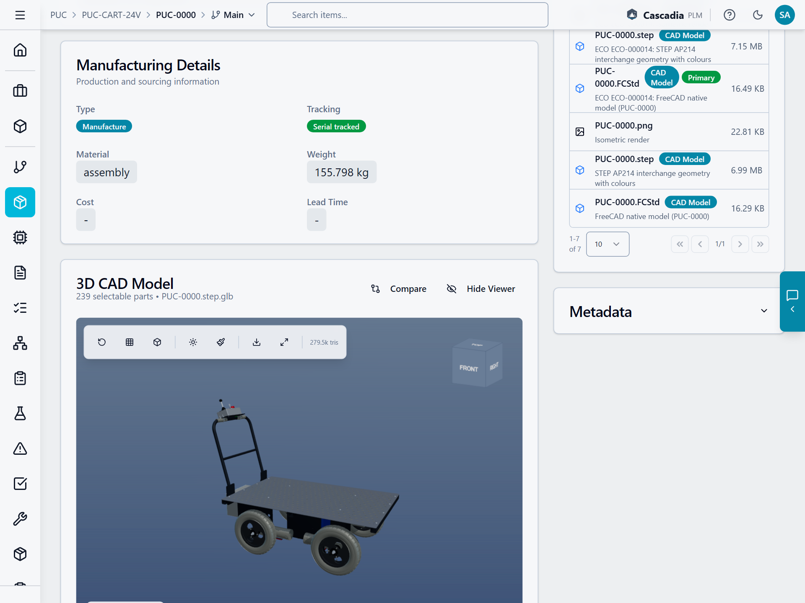
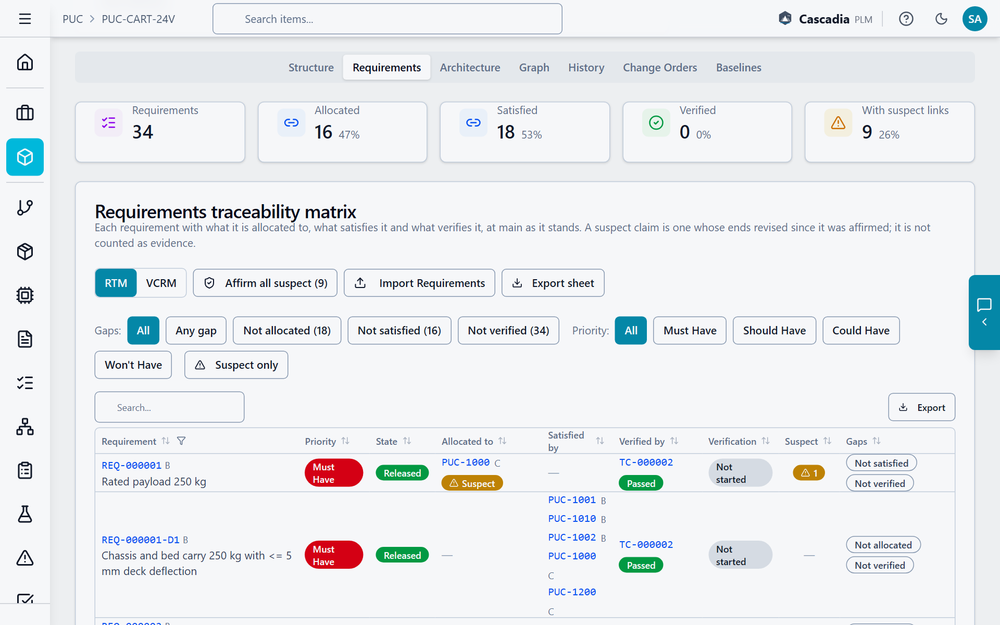
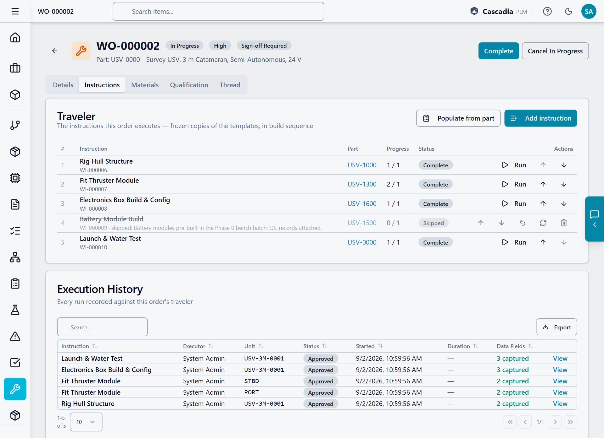

# Cascadia PLM

**Open-source product lifecycle management where every engineering change gets its own branch.**

Cascadia keeps a hardware team's parts, BOMs, CAD files, documents, requirements and build records in one system, and runs change control the way Git does. Each change order is an isolated branch: several changes can be in work on the same assembly at once, each one is reviewed as a set of differences, and nothing reaches released data until it is approved and merged.

The complete core is free to self-host under the AGPL, with no user limit.

[Website](https://cascadiaplm.com) · [Documentation](https://docs.cascadiaplm.com) · [Try the demo](#try-it-in-five-minutes) · [Feature list](./cascadia-feature-list.md) · [Licensing](./LICENSING.md)

https://github.com/user-attachments/assets/fce1368e-19af-463f-95a5-926c3f682022

## Why Cascadia

- **Changes run in parallel.** A change order opens a branch of the design, and edits stay on that branch until release. An urgent fix and a long-running redesign can touch the same assembly at the same time, and Cascadia reports where they conflict.
- **Released data stays released.** The main line cannot be edited directly. Every change arrives through an approved change order, and revision letters are assigned at the moment of release, so a revision always means something was approved.
- **One connected record.** A requirement links to the part that satisfies it, the test that verifies it, the work order that built it and the serial number that shipped. The digital thread view walks those links in either direction.
- **A complete core, free.** Parts, BOMs, change orders, documents, workflows, the file vault, search and the APIs are AGPL-3.0 with unlimited users. You run it on your own infrastructure and the data stays in your own PostgreSQL database.
- **Customized in code.** Item types, permissions and integrations are TypeScript kept in version control, so a customization is reviewed and tested like any other software instead of living in a vendor's configuration screens.

## A quick tour

The screenshots below come from the bundled demo data: a 24 V utility cart and a survey catamaran modelled in FreeCAD and KiCad, and a six-axis robot arm. [Run the demo](#try-it-in-five-minutes) to click through the same screens.

### A change order is a branch



ECO-000014 adds a drop-in wall kit to the cart. It revises two released parts (B → C and C → D) and releases four new ones at revision A. All of that work happened on the change order's own branch and reached the released design in a single merge when the change was approved.

### History you can follow

<p align="center">
  
</p>

Each release is a merge commit on the design's main line, tagged with the change order that caused it. Any earlier state of the design can be opened as it was, whether that is a commit, a branch or a named baseline.

### Bills of materials



Multi-level BOMs carry quantities, find numbers and reference designators, and every line shows the revision and lifecycle state in effect. Where-used runs the other way, and BOMs import from Excel or CSV.

### CAD files and 3D in the browser



The vault stores native CAD next to neutral formats, with check-out, check-in and version history. STEP and IGES files are converted on the server into a 3D view that anyone can open without a CAD seat. Click a component in the model to jump to its part record.

### Requirements traced to evidence



Requirements are allocated to parts, satisfied by the design and verified by test cases. The traceability matrix shows which ones are covered, and marks a link as suspect when either end has been revised since someone last confirmed it.

### From the design to the shop floor



A work order turns work instructions into a traveler, records every run and sign-off, and tracks the serial numbers and lots it consumed. The result is an as-built record you can compare against the design, or walk backwards when a lot is recalled.

## Try it in five minutes

The demo stack runs Cascadia with PostgreSQL, RabbitMQ, the CAD converter and the jobs worker, pre-loaded with the demo data shown above. It needs Docker and nothing else; there is no need to clone the repository:

```bash
curl -O https://raw.githubusercontent.com/Cascadia-PLM/Cascadia-App/main/docker-compose.demo.yml
docker compose -f docker-compose.demo.yml up -d
```

The first run pulls about 1.2 GB of pre-built images from GitHub Container Registry (2-5 minutes on a typical connection) and seeds the database. When `docker compose -f docker-compose.demo.yml logs app` shows the server is listening, open <http://localhost:3000> and log in with `admin@cascadia.local` / `Cascadia`.

Good places to start:

- **Programs → PUC → PUC-CART-24V** is the utility cart. The Structure tab holds its BOM, Requirements the traceability matrix and History the branch graph.
- **Change Orders → ECO-000014** is the wall-kit change shown above, in its released state.
- **Work Orders → WO-000002** is the catamaran build, with its traveler, consumed material and qualification rollup.
- **Programs → ROBOT-ARM → TDJ-25** is the robot arm: 88 parts, most with a 3D model.

Reset to a clean slate at any time:

```bash
docker compose -f docker-compose.demo.yml down -v
```

The demo's volumes are namespaced (`cascadia_demo_*`) and won't touch any local development data. Working from a clone instead? Use [`docker-compose.demo-with-build.yml`](./docker-compose.demo-with-build.yml) to build the images from your working tree.

## What's included

| Area                  | In the open core                                                                                                                                           |
| --------------------- | ---------------------------------------------------------------------------------------------------------------------------------------------------------- |
| Change management     | ECO, ECN, MCO and deviation change orders on their own branches, impact analysis, conflict detection, approval voting, configurable lifecycles             |
| Parts and BOMs        | Multi-level BOMs, where-used, product variants, approved manufacturer lists, spreadsheet import with BOM auto-detection                                    |
| Documents and CAD     | File vault with check-in/check-out and version history, local or S3-compatible storage, STEP/IGES conversion, in-browser 3D viewer                         |
| Versioning            | Branches, commits, merges and baseline tags for engineering data; field-level change history; personal workspaces for exploratory work                     |
| Requirements and V&V  | Requirement hierarchies, allocation, satisfaction and verification links, suspect-link tracking, test plans and cases, gap analysis, a traceability matrix |
| Systems engineering   | Logical architecture (system elements) realized by parts and software, and a SysML v2 API                                                                  |
| Manufacturing         | Work instructions, work orders with travelers and sign-offs, serialized units and lots, genealogy, as-built comparison, recall queries                     |
| Software and firmware | Software items with a versioned source store, per-file diffs and change-order control alongside the hardware they ship with                                |
| Platform              | REST API with an OpenAPI contract, webhooks, an ordered event log, role-based access by program, full-text search, reports, background jobs                |
| AI                    | A chat assistant that can query and edit PLM data with confirmation (bring your own Anthropic or OpenAI key), and an MCP server exposing the same tools    |

The [feature list](./cascadia-feature-list.md) tracks the status of every capability, including what is partial or planned. Two gaps worth knowing up front: manufacturing BOM management is at an early stage, and native CAD connectors (Solid Edge, SolidWorks) are planned for the commercial edition. Today CAD files reach Cascadia through the vault.

## How ECO-as-Branch works

1. **Create a change order.** Cascadia creates a branch from the design's main line.
2. **Check out the items it affects.** They are copied onto the branch as working copies.
3. **Make the changes.** Edits, new files and BOM changes are visible only on that branch.
4. **Approve and release.** The branch merges to main and the affected items receive their new revision letters.

A change order can release a new item, revise a released one, make one obsolete, or add and remove BOM lines. Its own review runs on a configurable lifecycle with approvers per state. [Versioning](./docs/features/versioning.md) and [change management](./docs/features/change-management.md) describe the model in depth.

Data is organized as **Program → Design → Items**. A program is the permission boundary, so users see only the programs they belong to. A design is the versioned container that holds the branches and commits.

## Deploying

Cascadia ships as container images and scales from one machine to a cluster:

| Deployment     | Best for                          | Guide                                                              |
| -------------- | --------------------------------- | ------------------------------------------------------------------ |
| Single server  | Development, small teams          | [single-server](./docs/orchestration/deployments/single-server/)   |
| Distributed    | High availability, 50+ users      | [distributed](./docs/orchestration/deployments/distributed/)       |
| Cloud database | Managed Postgres (RDS, Cloud SQL) | [cloud-database](./docs/orchestration/deployments/cloud-database/) |
| Kubernetes     | Enterprise, auto-scaling          | [kubernetes](./docs/orchestration/deployments/kubernetes/)         |

The [orchestration guide](./docs/orchestration/README.md) covers the services and their configuration, and [upgrading](./docs/deployment/upgrading.md) covers moving a production install between releases.

## For developers

Cascadia is TypeScript end to end: a [Hono](https://hono.dev/) API server, a [Vite](https://vite.dev/) and [TanStack Router](https://tanstack.com/router) single-page app, PostgreSQL 18 with [Drizzle ORM](https://orm.drizzle.team), RabbitMQ for background jobs, and a Python worker built on pythonocc for CAD conversion. Tests run on Vitest and Playwright.

### Run from source

You need Node.js 22+ and PostgreSQL 18+. Docker is optional and only needed for RabbitMQ and the workers.

```bash
npm install

cp .env.example .env    # then set DATABASE_URL

npm run db:push         # create the schema (development only)
npm run db:seed         # admin user, roles, default lifecycles

npm run dev             # http://localhost:3000
```

The seed creates a bootstrap admin account (`admin@cascadia.local` / `Cascadia`) for local development. **Change that password immediately on any shared or production deployment.** To load the demo datasets into a source checkout, run `npm run demo:fetch && npm run seed:demo`.

[SETUP.md](./SETUP.md) has the full walkthrough, including workers, object storage and OAuth.

### How the code is organized

An npm workspace of four packages with a one-way dependency graph, plus the app that composes them:

| Package                | Role                                                                             |
| ---------------------- | -------------------------------------------------------------------------------- |
| `cascadia-commons`     | Shared by server and client: item schemas, permissions, lifecycle and wire types |
| `cascadia-api`         | The server: routes, services, the database schema, jobs, events, AI tools        |
| `cascadia-web`         | The client: routes, components, the query layer                                  |
| `cascadia-workers-job` | The background jobs worker                                                       |
| `cascadia-app`         | Composition root: entry points, build configuration, migrations, Dockerfile      |

`cascadia-workers-cad` holds the Python CAD converter. The [architecture overview](./docs/architecture/overview.md) explains how the pieces fit together.

### Extending it

- **Item types** are defined in code, with a Zod schema, a table and a registered handler. See [adding item types](./docs/development/adding-item-types.md).
- **Extensions** react to domain events in three phases: guard an operation, join its transaction, or consume it afterwards. See [writing extensions](./docs/development/writing-extensions.md).
- **Integrations** use the [REST API](./docs/api/README.md), signed [webhooks](./docs/features/webhooks.md) or the [MCP server](./docs/features/mcp.md).

## Documentation

- [Documentation site](https://docs.cascadiaplm.com), or the same content in-repo under [`docs/`](./docs/README.md)
- [Setup guide](./SETUP.md) for installation and configuration
- [Feature list](./cascadia-feature-list.md) for the status of every capability
- [Changelog](./CHANGELOG.md)
- [CLAUDE.md](./CLAUDE.md), the development guide for AI coding assistants

## Contributing

See [CONTRIBUTING.md](./CONTRIBUTING.md) for guidelines. Security issues should be reported per [SECURITY.md](./SECURITY.md).

## License

Cascadia is an **open-core, dual-licensed** project.

The core PLM — parts, BOMs, ECO-as-Branch change management, documents, workflows, vault, search, and APIs — is licensed under the [GNU Affero General Public License v3.0 or later](./LICENSE), forever, with unlimited users. The AGPL's network-use clause means that if you run a modified version of Cascadia as a service, you must make the source available to users of that service.

If the AGPL doesn't work for your organization, or you need enterprise capabilities (CAD connectors, SSO/AD, compliance pack, the AI Design Engine, support SLAs), a commercial license is available — see [LICENSING.md](./LICENSING.md) or contact [kai@cascadiaplm.com](mailto:kai@cascadiaplm.com).

Contributions require signing the [CLA](./CLA.md); see [CONTRIBUTING.md](./CONTRIBUTING.md).

## Support

For usage questions, see the documentation in [`docs/`](./docs/). For bugs and feature requests, open a GitHub issue.
